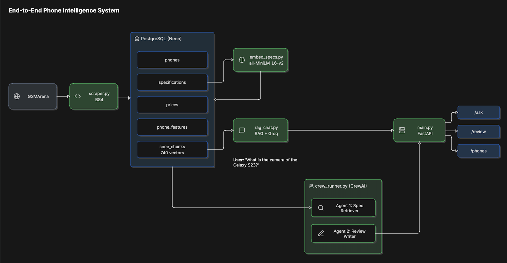

# Samsung Phone Query & Review System

An end-to-end intelligent smartphone information and review generation system that scrapes Samsung smartphone specifications from GSMArena, stores structured data in PostgreSQL, answers natural-language questions using Retrieval-Augmented Generation (RAG), generates detailed product reviews through a CrewAI multi-agent pipeline, and exposes all functionalities through a FastAPI service.

## Project Status

| Component | Status | Evidence |
|---|---|---|
| Web Scraper (GSMArena) | Completed | `scraper.py` |
| PostgreSQL Database | Completed | `db.py`, `rag_schema.py` |
| RAG Chatbot | Completed | `rag_chat.py` |
| CrewAI Multi-Agent System | Completed | `agents.py`, `crew_runner.py` |
| FastAPI Service | Completed | `main.py` |

## System Architecture



The system follows a modular architecture consisting of five major components:

1. **Data Collection:** Scrapes Samsung smartphone specifications from GSMArena using Requests and BeautifulSoup4.
2. **Database Management:** Stores smartphone information, specifications, and structured features in PostgreSQL with pgvector support.
3. **Retrieval-Augmented Generation (RAG):** Converts natural-language questions into embeddings, retrieves relevant smartphone information, and generates contextual answers using an LLM.
4. **Multi-Agent Review Generation:** Uses CrewAI agents to analyze smartphone specifications and generate comprehensive product reviews.
5. **REST API:** Provides endpoints through FastAPI for accessing phone data, asking questions, and generating reviews.

## Tech Stack

| Category | Technology |
|---|---|
| Programming Language | Python 3.12 |
| Web Scraping | Requests, BeautifulSoup4 |
| Database | PostgreSQL 18 |
| Vector Database | pgvector 0.8.7 |
| ORM | SQLAlchemy 2.1 |
| Data Modeling | SQLAlchemy Typed Mapped[] |
| Embedding Model | sentence-transformers/all-MiniLM-L6-v2 |
| Embedding Dimensions | 384 |
| LLM Provider | Groq API |
| RAG Model | openai/gpt-oss-20b |
| Review Generation Model | openai/gpt-oss-120b |
| Multi-Agent Framework | CrewAI 1.15 |
| API Framework | FastAPI |
| ASGI Server | Uvicorn |
| Database Hosting | Neon PostgreSQL (Free Tier) |

## Dataset Overview

The system currently contains information about 13 Samsung smartphones collected from GSMArena.

| Smartphone | Specification Rows | Release Year | Chipset |
|---|---:|---:|---|
| Galaxy A17 | 54 | 2025 | Exynos 1330 |
| Galaxy A26 | 55 | 2025 | Exynos 1380 |
| Galaxy A36 | 56 | 2025 | Snapdragon 6 Gen 3 |
| Galaxy A57 | 53 | 2026 | Exynos 1680 |
| Galaxy S22 5G | 57 | 2022 | Exynos 2200 / Snapdragon 8 Gen 1 |
| Galaxy S23 | 58 | 2023 | Snapdragon 8 Gen 2 |
| Galaxy S23 FE | 50 | 2023 | Exynos 2200 |
| Galaxy S23+ | 58 | 2023 | Snapdragon 8 Gen 2 |
| Galaxy S24 | 57 | 2024 | Snapdragon 8 Gen 3 |
| Galaxy S25 | 60 | 2025 | Snapdragon 8 Elite |
| Galaxy S25 Ultra | 61 | 2025 | Snapdragon 8 Elite |
| Galaxy S26 | 60 | 2026 | Snapdragon 8 Elite Gen 5 |
| Galaxy S26 Ultra | 61 | 2026 | Snapdragon 8 Elite Gen 5 |

Each smartphone also has a structured `phone_features` record containing: display size and technology, resolution, chipset, OS, RAM and storage, main camera MP, selfie camera MP, battery mAh, charging speed (W), active-use score, endurance rating, and weight.

**Dataset Summary:**
- Total smartphones: 13
- Total specification records: Approximately 740
- Structured feature records: 13

## Core Features

### 1. Automated Web Scraping
- Extracts Samsung smartphone specifications from GSMArena.
- Uses Requests and BeautifulSoup4 for data collection.
- Organizes scraped information into structured records.
- Supports storing smartphone specifications in PostgreSQL.

### 2. PostgreSQL Database
- Uses PostgreSQL with SQLAlchemy ORM.
- Implements relational database tables and foreign-key constraints.
- Supports vector storage through pgvector.
- Stores both detailed specifications and structured smartphone features.

### 3. Retrieval-Augmented Generation (RAG)
- Uses `all-MiniLM-L6-v2` for generating 384-dimensional embeddings.
- Retrieves relevant smartphone information from the database.
- Uses Groq-hosted LLM inference for contextual responses.
- Answers natural-language questions based on the collected dataset.

### 4. CrewAI Multi-Agent Review Generation
- Uses two specialized AI agents.
- Analyzes smartphone specifications.
- Generates structured product reviews of approximately 300¡V400 words.
- Uses Groq's `openai/gpt-oss-120b` model for review generation.

### 5. FastAPI REST Service

The application exposes the following endpoints:

| Method | Endpoint | Description |
|---|---|---|
| GET | `/health` | Checks application health |
| GET | `/phones` | Retrieves available Samsung smartphones |
| POST | `/ask` | Answers natural-language smartphone queries |
| POST | `/review` | Generates AI-powered smartphone reviews |

## Project Structure

```text
Samsung-Phones-Query-and-Review-System/
|-- scraper.py
|-- db.py
|-- rag_schema.py
|-- rag_chat.py
|-- agents.py
|-- crew_runner.py
|-- main.py
|-- seed_from_csv.py
|-- data/
|   |-- seed/ (CSV data exports)
|-- requirements.txt
|-- .env
|-- .gitignore
|-- README.md